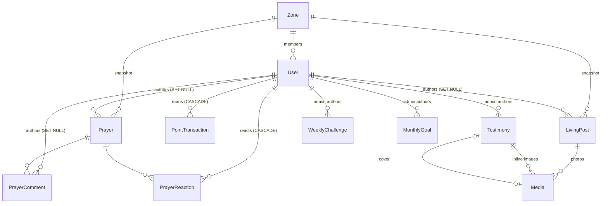

# Architecture — AP Building Fund Mini App

## Stack

| Layer      | Choice                                                         |
|------------|----------------------------------------------------------------|
| Frontend   | React + Vite + TypeScript + `@telegram-apps/sdk` (`web/`, Phase 4) |
| Backend    | Node.js + TypeScript + Express (`server/`, Phase 2)            |
| Bot + cron | `node-telegram-bot-api` + `node-cron`, same process as the API (Phase 3) |
| Database   | **PostgreSQL 16 + Prisma 7** (`server/prisma/schema.prisma`)    |

### Why PostgreSQL over MongoDB

The data is relational: users belong to zones, posts and prayers belong to
users, points roll up to users and then to zones. Postgres gives us:

- **Unique constraints that enforce point caps** under concurrent taps (see below).
- **Foreign-key actions** that make "Delete my data" correct by construction
  (`CASCADE` on points and reactions, `SET NULL` on content).
- **`GROUP BY` aggregation** for the Cell Group leaderboard in one query.
- **Multi-row transactions**, so a ledger insert and the `totalPoints` cache never drift apart.

## Repository layout

```
server/
  prisma/schema.prisma     data model
  prisma/migrations/       SQL migrations (committed)
  prisma/seed.ts           zones + sample week/month content
  prisma.config.ts         Prisma 7 config (DB URL, seed command)
  src/db.ts                PrismaClient (pg driver adapter)
web/                       React Mini App (Phase 4)
docs/
```

## Data model



## Key design decisions

### 1. Points are a ledger; caps are enforced by the database
Every award is a `PointTransaction` row with the unique key
`(userId, type, periodKey, slot)`:

| Trigger       | `periodKey`  | `slot`            | Effect                         |
|---------------|--------------|-------------------|--------------------------------|
| `TITHE`       | `2026-10`    | `1`               | once per SGT month             |
| `MEAL_LOG`    | `2026-10-13` | `1..3`            | max 3 per SGT day              |
| `LIVING_POST` | `2026-10-13` | `1..N`            | configurable daily cap         |
| `ADMIN_ADJUSTMENT` | cuid    | `1`               | one row per manual adjustment  |

Two concurrent taps cannot both claim the same slot: the loser gets a `P2002`
error, which the API turns into "daily limit reached". Tested: four rapid meal
logs give three awards and one rejection.

`User.totalPoints` is a cache updated in the same transaction as the insert, so
the individual leaderboard is an indexed `ORDER BY totalPoints DESC`. The CG
leaderboard is `SUM(totalPoints) GROUP BY zoneId`.

Point **values** (e.g. tithe = 100, meal = 5, post = 20) live in app config, not
the schema, so they can be tuned without a migration.

### 2. "Delete my data" is mostly enforced by foreign keys
`DELETE FROM users WHERE id = ?` in one transaction:

- **PII** (name, username, photo, PIN hash, Telegram ID): gone with the row.
- **Prayers, comments, Living posts**: `authorId → NULL`, so they render as **"Former Member"**.
  The post keeps its own `zoneId` snapshot, so zone filters still work.
- **Point ledger**: `CASCADE` deletes it, so the user's points leave the individual
  board **and** their CG total immediately.
- **Reactions**: `CASCADE` (they identify the person).
- **Audit trail**: one `USER_SELF_DELETE` row with no identifying metadata.

Tested against a live Postgres: after deletion the prayer survives with
`authorId = null`, its zone is kept, and no reactions or ledger rows remain.

### 3. Time is always Singapore time (UTC+8)
Daily caps, streaks, "current week" and monthly goals use SGT calendar days
(`@db.Date` columns plus `periodKey` strings). A `WeeklyChallenge` becomes current
when `now() >= publishAt` (Monday 05:00 SGT = Sunday 21:00 UTC). The Home screen
and the Monday cron both use that rule, so the app shows the new challenge as
soon as the broadcast goes out, with no separate sync step.
`broadcastStartedAt/CompletedAt` make the cron idempotent if the process restarts.

### 4. Testimonies are structured JSON blocks, not HTML
`Testimony.blocks` is an array like `{type: "paragraph" | "heading" | "image" | "quote", ...}`,
validated with zod. The client renders plain React elements, so there is no
`dangerouslySetInnerHTML` and no XSS risk. There are deliberately no comment
or reaction relations on testimonies.

### 5. Admins
`ADMIN_TELEGRAM_IDS` (env) is the bootstrap whitelist: those IDs are forced to
`ADMIN` on every authenticated request. Admins promoted in-app are stored as
`User.role = ADMIN`. Every promotion and content change writes an `AuditLog` row.

### 6. Privacy
- **Private Journal**: `localStorage` only. Nothing about it is in the schema.
- **PIN lock**: stored server-side as a scrypt hash, with an attempt counter and
  lockout, so clearing local storage can't bypass it. Users reset it through the
  bot, which is already Telegram-authenticated.
- **Name display**: `stayAnonymous` and `showOnBoards` are resolved into a public
  name by one server-side function (Phase 2). The client never gets the real
  name of someone it isn't allowed to see.

## Local development

```bash
docker compose up -d db              # or any Postgres 16
cp server/.env.example server/.env
npm install
npm run db:migrate                   # applies prisma/migrations
npm run db:seed                      # zones ZN1–ZN4 + sample week/month
```
