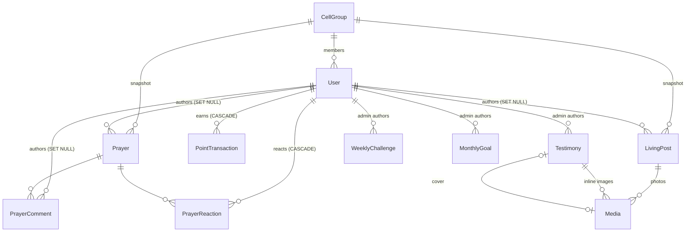

# Architecture — AP Building Fund Mini App

## Stack

| Layer      | Choice                                                         |
|------------|----------------------------------------------------------------|
| Frontend   | React 19 + Vite 8 + TypeScript + `@twa-dev/sdk`, React Router, TanStack Query (`web/`) |
| Backend    | Node.js + TypeScript + Express (`server/`, Phase 2)            |
| Bot + cron | `node-telegram-bot-api` v2 + `node-cron` v4, same process as the API |
| Database   | **PostgreSQL 16 + Prisma 7** (`server/prisma/schema.prisma`)    |

### Why PostgreSQL over MongoDB

The data is relational: users belong to Cell Groups, posts and prayers belong to
users, points roll up to users and then to Cell Groups. Postgres gives us:

- **Unique constraints that enforce point caps** under concurrent taps (see below).
- **Foreign-key actions** that make "Delete my data" correct by construction
  (`CASCADE` on points and reactions, `SET NULL` on content).
- **`GROUP BY` aggregation** for the Cell Group leaderboard in one query.
- **Multi-row transactions**, so a ledger insert and the `totalPoints` cache never drift apart.

## Repository layout

```
server/
  prisma/schema.prisma        data model
  prisma/migrations/          SQL migrations (committed)
  prisma/seed.ts              Cell Groups AP1–AP4 (+ optional sample content)
  src/index.ts                process entry: HTTP server + bot polling + cron
  src/bot.ts                  /start, /help, /resetpin, block tracking
  src/cron.ts                 Monday 05:00 SGT schedule + catch-up sweep
  src/app.ts                  Express app: helmet, CORS, rate limits, routes
  src/config.ts               zod-validated environment
  src/lib/telegramInitData.ts initData HMAC-SHA256 validation
  src/lib/storage.ts          Cloudflare R2 / S3 client + image processing
  src/lib/privacy.ts          who may see whose real name
  src/lib/time.ts             Singapore-time and campaign-week helpers
  src/lib/pin.ts              scrypt PIN hashing
  src/middleware/             telegramAuth, requireAdmin, rate limits, errors
  src/services/               points (caps, streaks), users (sync, delete), broadcast, leaderboard
  src/routes/                 /api/me, /home, /points, /cell-groups, /uploads,
                              /prayers, /living, /testimonies, /leaderboard, /admin
  scripts/sign-init-data.ts   signed auth header for local curl testing
  test/                       vitest: unit + API tests against Postgres
web/
  src/telegram.ts             SDK bridge: getInitData(), ready/expand, BackButton
  src/api/client.ts           fetch wrapper that injects `Authorization: tma <initData>`
  src/api/index.ts            React Query hooks for every endpoint
  src/components/             BottomNav, Layout, AuthGate, PinGate, UI bits
  src/pages/                  Home, Prayer, Living, Testimonies, Me, Leaderboard
  src/pages/admin/            Weekly challenges, Monthly goals, Stories (block editor), People
  src/lib/blocks.ts           testimony editor helpers (reorder, strict API payload)
docs/                         this file, API.md
```

## Data model



## Key design decisions

### 1. Points are a ledger; caps are enforced by the database
Every award is a `PointTransaction` row with the unique key
`(userId, type, periodKey, slot)`:

| Trigger            | Points | `periodKey`  | `slot` | Cap                        |
|--------------------|--------|--------------|--------|----------------------------|
| `TITHE`            | 100    | `2026-10`    | `1`    | 1 per SGT month            |
| `MEAL_LOG`         | 5      | `2026-10-13` | `1..3` | 3 per SGT day (15 pts)     |
| `LIVING_POST`      | 10     | `2026-10-13` | `1..2` | 2 per SGT day (20 pts)     |
| `ADMIN_ADJUSTMENT` | ±n     | cuid         | `1`    | one row per adjustment     |

Two concurrent taps cannot both claim the same slot: the loser gets a `P2002`
error and moves to the next slot until the cap. Tested: 8 concurrent meal-log
requests award exactly 3. Posting past the Living-post cap is still allowed; it
just earns no more points that day.

`User.totalPoints` is a cache updated in the same transaction as the insert, so
the individual leaderboard is an indexed `ORDER BY totalPoints DESC`. The CG
leaderboard is `SUM(totalPoints) GROUP BY cellGroupId`.

Point values and caps live in `POINT_RULES` (`src/services/points.ts`), not the
schema, so they can be tuned without a migration. The tithe log is a
declaration that this month's tithe is done. **No amount is ever asked for or stored.**

Streaks count consecutive SGT days with at least one point-earning action, and
are updated in the same SQL statement as the points total.

### 2. "Delete my data" is mostly enforced by foreign keys
`DELETE FROM users WHERE id = ?` in one transaction:

- **PII** (name, username, photo, PIN hash, Telegram ID): gone with the row.
- **Prayers, comments, Living posts**: `authorId → NULL`, so they render as **"Former Member"**.
  The post keeps its own `cellGroupId` snapshot, so CG filters still work.
- **Point ledger**: `CASCADE` deletes it, so the user's points leave the individual
  board **and** their CG total immediately.
- **Reactions**: `CASCADE` (they identify the person).
- **Uploads never attached to a post**: rows and R2 objects deleted.
- **Audit trail**: one `USER_SELF_DELETE` row with no identifying metadata.

The API requires `{"confirm": "DELETE"}` in the body. Covered by `test/api.test.ts`.

### 3. Time is always Singapore time (UTC+8)
Daily caps, streaks, "current week" and monthly goals use SGT calendar days
(`@db.Date` columns plus `periodKey` strings). A `WeeklyChallenge` becomes current
when `now() >= publishAt` (Monday 05:00 SGT = Sunday 21:00 UTC). The Home screen
and the Monday cron both use that rule, so the app shows the new challenge as
soon as the broadcast goes out, with no separate sync step.
`broadcastStartedAt/CompletedAt` make the cron idempotent if the process restarts.

### 4. Testimonies are structured JSON blocks, not HTML
`Testimony.blocks` is an array like `{type: "paragraph" | "heading" | "image" | "quote", ...}`,
validated with zod. The client renders plain React elements, so there is no
`dangerouslySetInnerHTML` and no XSS risk. There are deliberately no comment
or reaction relations on testimonies.

### 5. Admins
`ADMIN_TELEGRAM_IDS` (env) is the bootstrap whitelist: those IDs are forced to
`ADMIN` on every authenticated request. Admins promoted in-app are stored as
`User.role = ADMIN`. Every promotion and content change writes an `AuditLog` row.

### 6. Privacy
- **Private Journal**: `localStorage` only. Nothing about it is in the schema.
- **PIN lock**: stored server-side as a scrypt hash, with an attempt counter and
  lockout, so clearing local storage can't bypass it. Users reset it through the
  bot, which is already Telegram-authenticated.
- **Name display** is decided server-side in `src/lib/privacy.ts`, so the
  client never receives a real name it isn't allowed to see.

  **Individual leaderboard**

  | Stay Anonymous | Show me on boards | Listed? | Name shown                                    |
  |----------------|-------------------|---------|-----------------------------------------------|
  | ON             | (any)             | No      | (points still count toward the CG total)      |
  | OFF            | ON (default)      | Yes     | real name to CG peers, "Anonymous" to others  |
  | OFF            | OFF               | Yes     | real name to everyone                         |

  **Feeds** (Prayer Wall, Living it Out, comments): "Anonymous" if Stay Anonymous
  is ON or the post was marked anonymous, otherwise the real name. Authors always
  see their own name. A deleted author is "Former Member".
- **Cell Group changes**: members pick their CG once. Because CG totals follow
  current membership, later changes go through an admin so points can't be
  moved between teams.

## Security model (Phase 2)

1. **Authentication: Telegram `initData`, HMAC-SHA256.** Every `/api` request
   carries `Authorization: tma <Telegram.WebApp.initData>`. `telegramAuth`
   recomputes the signature: `secret = HMAC_SHA256("WebAppData", BOT_TOKEN)`,
   `hash = HMAC_SHA256(secret, sorted "key=value" lines)`. It compares the hashes
   in constant time, rejects payloads older than `INIT_DATA_MAX_AGE_SECONDS` (or
   dated in the future), duplicate keys and bot accounts. Only then does it load
   the user by the **signed** Telegram ID. `initDataUnsafe` is never used. Tests
   check our signer against an independent implementation written from the
   Telegram docs, and check that a forged `user.id` is rejected.
2. **Authorisation.** The role comes from the database row loaded for the
   request, never from the client. `ADMIN_TELEGRAM_IDS` are promoted
   automatically. `requireAdmin` guards admin routes.
3. **Input.** Every body and query is validated with zod `.strict()` schemas,
   so unknown fields such as `role` are rejected. JSON bodies are capped at 100 kB.
4. **Uploads.** Uploads are authenticated, limited to 10 MB and 30 per hour per
   user, and decoded and **re-encoded to WebP** server-side. Anything that isn't
   a real image is rejected, and all metadata (including **EXIF GPS location**)
   is stripped. Storage keys are random UUIDs.
5. **Transport and headers.** helmet, CORS restricted to `WEBAPP_URL`, and
   `Cache-Control: no-store` on API responses. Auth is a header, not a cookie,
   so there is no CSRF surface.
6. **Abuse.** Per-IP and per-user rate limits (in-memory: use a Redis store if
   you run more than one instance). PIN brute force gets locked out after 5
   wrong attempts for 15 minutes.
7. **Errors.** Errors are returned as `{ error: { code, message } }`. Stack
   traces and database details never reach the client.

## Photo storage (Cloudflare R2)

`src/lib/storage.ts` uses `@aws-sdk/client-s3`, so any S3-compatible bucket
works. For R2:

1. Create a bucket (e.g. `ap-building-fund`).
2. Go to **R2 → Manage API tokens** and create a token with *Object Read & Write*
   scoped to that bucket. Copy the access key ID and secret into `S3_ACCESS_KEY_ID`
   and `S3_SECRET_ACCESS_KEY`.
3. Set `S3_ENDPOINT=https://<ACCOUNT_ID>.r2.cloudflarestorage.com` and `S3_REGION=auto`.
4. Either connect a public custom domain (or enable r2.dev) and set
   `MEDIA_PUBLIC_BASE_URL`, or leave it empty to keep the bucket private and
   serve 1-hour presigned URLs.

Without these variables the server still runs; only uploads return 503.

## Bot and Monday broadcast (Phase 3)

The bot runs in the same process as the API (`src/index.ts`) and long-polls
Telegram. If Telegram is unreachable at boot, it retries in the background
while the API keeps serving.

| Command / update | Effect |
|------------------|--------|
| `/start`         | Upserts the user by Telegram ID (`botStartedAt` set, `botBlocked` cleared) and replies with a welcome message and an inline **web_app** button that opens `WEBAPP_URL`. In groups it asks people to message privately. |
| `/help`          | Lists commands, with the app button. |
| `/resetpin`      | Removes the sender's app PIN (forgotten-PIN recovery). |
| `my_chat_member` | Telegram reports block/unblock: sets/clears `botBlocked`. |

### Timezone handling

1. **The schedule.** `cron.ts` registers `0 5 * * 1` with `timezone: "Asia/Singapore"`.
   node-cron evaluates the expression in that zone (via `Intl`), not in the
   host's local time. It fires at Monday 05:00 SGT, which is Sunday 21:00 UTC,
   wherever the server runs. Singapore has no daylight saving, so the instant
   never drifts.
2. **The data.** Inside the job, "this week" and "this month" come from
   `lib/time.ts`, which applies the fixed +08:00 offset explicitly
   (`sgWeekStart`, `sgMonthStart`). It never reads the host's `TZ`.
3. **The handshake with the Mini App.** A challenge's `publishAt` is stored as
   the UTC instant of Monday 05:00 SGT. The broadcast and `GET /api/home` both
   use "latest challenge with `publishAt <= now`", so the moment the push goes
   out, the app shows the same challenge.
4. **Proof.** The whole test suite runs with `TZ=America/New_York`. The cron
   tests check the server's real task matches `2026-10-18T21:00Z` (Mon 05:00 SGT)
   and not Monday 05:00 UTC or New York, and that its next 10 runs are all
   Sunday 21:00 UTC, exactly 7 days apart.

### Broadcast flow (`services/broadcast.ts`)

1. Find **this SGT week's** challenge (`SCHEDULED`/`PUBLISHED`, `publishAt`
   passed within the last 24 h). Last week's is never re-sent.
2. **Claim it atomically**: `UPDATE … SET broadcastStartedAt = now WHERE broadcastStartedAt IS NULL`.
   Only one caller wins, so the Monday job, the 15-minute catch-up sweep, a
   restart or a second instance can't send twice.
3. Load this month's `MonthlyGoal` and build one HTML message (verse,
   initiatives, goal; admin text escaped and clipped under 4096 characters)
   with the app button.
4. Page through users who are not `botBlocked` and have `notificationsEnabled`,
   200 at a time. Each `sendMessage` has its own `try/catch`. On 403 (blocked)
   or "chat not found", the user is logged by internal ID and flagged
   `botBlocked`. Other errors are logged. Either way the loop continues.
   Sending is throttled to 25 msgs/s, and 429s are retried honouring `retry_after`.
5. Record `broadcastCompletedAt` and the sent/failed counts on the challenge.

**Catch-up sweep** (`*/15 * * * *`, also at startup): if the server was down
at 05:00, or an admin publishes this week's challenge late, the broadcast still
goes out within 15 minutes, as long as it's within 24 h of `publishAt`.

**Limitation:** if the process dies mid-broadcast, the challenge stays claimed
and the remaining users are not retried automatically, so nobody gets a duplicate.
The counts on the challenge show it.

## Frontend (Phase 4)

### How `initData` reaches the server

1. Telegram opens `WEBAPP_URL` with the signed launch data in the URL hash
   (`#tgWebAppData=…`). `@twa-dev/sdk` loads Telegram's official
   `telegram-web-app.js`, which parses it into `Telegram.WebApp.initData` (and
   keeps it in `sessionStorage`, so a reload still works).
2. `getInitData()` (`src/telegram.ts`) returns that **raw string** unchanged.
   `initDataUnsafe` is never read: it's an unsigned copy the page could alter.
3. The one API client (`src/api/client.ts`) calls `getInitData()` on **every**
   request and sets `Authorization: tma <initData>`. That covers GET, JSON
   writes and multipart uploads (where the browser sets the boundary). No
   component builds its own headers. Without initData it refuses to call the
   API at all.
4. The server's HMAC middleware verifies it (Phase 2). `AuthGate` renders
   nothing until `GET /api/me` succeeds. On `401` (expired or invalid) it shows
   "Open from Telegram" instead of retrying.

Verified in a real browser against the running server: 12 of 12 API requests
carried the header, a forged `user.id` was rejected, and a plain browser
without launch data made no API calls.

### Routing

`BrowserRouter` routes `/`, `/prayer`, `/living`, `/testimonies`
(`/testimonies/:slug` for the reader), `/me` and `/admin`. The bottom tab bar is
persistent. The **Admin** tab and route appear only when `/api/me` returns
`isAdmin: true`. That's cosmetic; the server enforces admin-only actions
itself. Hash routing isn't used because Telegram puts its launch data in the
hash. The host must serve `index.html` for every path: `public/_redirects`
does this on Cloudflare Pages and Netlify.

Data is fetched with TanStack Query. Home always refetches when the app opens
or regains focus (including Telegram's `activated` event), so Monday's
challenge appears right after 05:00 SGT.

## Leaderboards and Admin Dashboard (Phase 5)

**Leaderboards** (`/leaderboard`, previewed on Home): an Individuals / Cell Groups
toggle. Both are computed server-side (`services/leaderboard.ts`), so the
privacy rules in `lib/privacy.ts` decide every name before it leaves the
server. The individual board reads the indexed `users.totalPoints`. The CG
board is a single `GROUP BY cellGroupId`.

**Admin Dashboard** (`/admin`, admins only, with server-side `requireAdmin` on `/api/admin`):

| Section | What admins do |
|---------|----------------|
| Weekly  | Pick a campaign week (1–19), enter the initiatives, memory verse and reference, then Schedule or save a draft. A status badge shows Draft / Scheduled (with the SGT time) / Live / Sent to N. Scheduled challenges are what the Monday 05:00 cron broadcasts. |
| Monthly | One spiritual goal per campaign month. It shows on Home and is included in each Monday message. |
| Stories | Block editor: headings, paragraphs, quotes/verses and photos, added in any order, moved up/down and removed. There's a live preview with the same renderer as the reader, plus "paste a whole story" to turn text into blocks, a cover photo, and save as draft or publish. |
| People  | Search by name or @username, make or remove admins (with a native confirm), and move members between Cell Groups. You can't demote yourself or a whitelisted admin. |

## Deploying: Render + Supabase

| Variable       | Supabase connection (Project → Connect)                         | Used by |
|----------------|------------------------------------------------------------------|---------|
| `DATABASE_URL` | **Transaction pooler**, port 6543, append `?pgbouncer=true`     | the running app |
| `DIRECT_URL`   | **Session pooler**, port 5432 (IPv4, works on Render free tier) | Prisma CLI: `migrate deploy` |

The transaction pooler can't run migrations (no session state or advisory
locks); the session pooler can. `prisma.config.ts` makes the CLI use
`DIRECT_URL` whenever it's set.

**Render build command:** `npm install && npm run render-build`. That's
`prisma generate`, compile, then `prisma migrate deploy`. If a migration fails,
the build fails and the previous version keeps running. Start command:
`npm start`.

**Without CLI access (SQL Editor):** paste
`server/prisma/supabase/apply-migrations.sql` into Supabase → SQL Editor → Run.
It holds every migration, skips the ones already recorded, records new ones in
`_prisma_migrations` exactly like `prisma migrate deploy` (same checksums, so
both methods can be mixed), and runs in one transaction. After adding a
migration, run `npm run db:sql`. A test fails if the file is out of date.

**Row Level Security** is enabled on every table (migration
`enable_row_level_security`), so Supabase's public Data API (anon key) can't
read them. The app connects as the table owner and is unaffected. Any new
table needs `ALTER TABLE … ENABLE ROW LEVEL SECURITY` in its migration.

Never use `prisma db push` against production: it bypasses migration history.

## Local development

```bash
docker compose up -d db              # or any Postgres 16
cp server/.env.example server/.env
npm install
npm run db:migrate                   # applies prisma/migrations
npm run db:seed                      # Cell Groups AP1–AP4
npm run dev                          # API on :3000
npm test                             # needs Postgres; uses ap_building_fund_test

# Frontend on :5173 (proxies /api to :3000)
npm run dev:web
# To use it in a normal browser, put a signed value in web/.env:
#   VITE_DEV_INIT_DATA=<output of sign-init-data without the "tma " prefix>

# Call the API outside Telegram with a correctly signed header:
curl -H "Authorization: $(npm run -s sign-init-data -w server -- 123456789 Grace)" \
     localhost:3000/api/me
```
